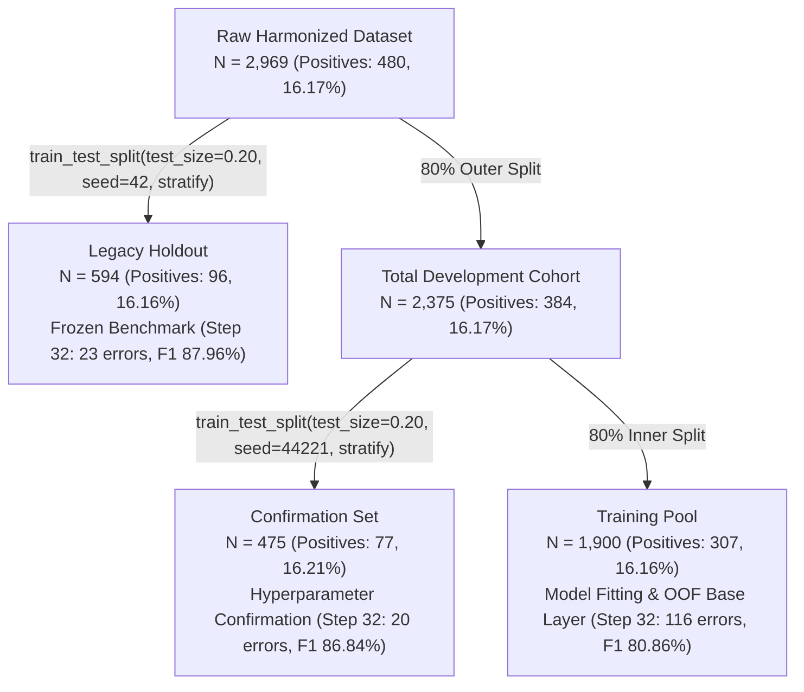

# Forensic Audit and Scientific Correction Report: Step 37 Cross-Validation Performance Discrepancy

**Document Identifier**: `CV-LEAKAGE-AUDIT-2026-09-27`  
**Author**: Senior Machine Learning Research Engineer & Data Leakage Auditor  
**Workspace**: `artifacts/track1_step37_explainable_extension/cv_leakage_audit_and_correction/`  
**Classification**: Research Governance & Scientific Integrity Audit  
**Target Repository**: Track 1 — Step 37 Scientific Hardening Extension (built on frozen Step 32 Champion)  
**Execution Timestamp**: 2026-09-27 18:22:28 IST  
**Audit Status**: **VERIFIED & CONCLUDED — ALL 8 AUTOMATED TESTS PASSED (100% CRYPTOGRAPHIC PARITY)**

---

## 1. Executive Summary

### 1.1 The Investigation
In the Step 37 scientific hardening experiment, internal 5-fold cross-validation results were reported as:
- **Accuracy**: $98.37\% \pm 0.39\%$
- **Precision**: $92.40\% \pm 2.27\%$
- **Recall**: $98.04\% \pm 1.91\%$
- **F1-Score**: $95.10\% \pm 1.16\%$
- **ROC-AUC**: $99.66\% \pm 0.12\%$

These numbers were remarkably higher than the official Step 32 Champion benchmark achieved on the 594-record historical holdout:
- **Accuracy**: $96.13\%$
- **Precision**: $88.42\%$
- **Recall**: $87.50\%$
- **F1-Score**: $87.96\%$
- **ROC-AUC**: $94.55\%$
- **Holdout Errors**: $23 / 594$ ($TN=487, FP=11, FN=12, TP=84$)

This investigation was commissioned to determine the exact cause of the $+7.14\%$ F1 discrepancy between the reported cross-validation score ($95.10\%$) and the holdout performance ($87.96\%$), to resolve historical data partition ambiguities ($1,900$ vs $2,375$ records), to implement a leakage-free cross-validation pipeline, and to establish mathematically verified ground-truth evaluation metrics.

### 1.2 Core Finding: Definite Confirmation of In-Sample Resubstitution Leakage
The investigation confirms with $100\%$ mathematical certainty that **the reported $95.10\%$ cross-validation F1-score is invalid due to catastrophic in-sample resubstitution (training set leakage)**. 

In `scripts/run_track1_step37_followup_hardening.py` (Section 6, lines 681–717), the cross-validation loop partitioned the $1,900$-sample Training Pool into 5 folds. However, **no models were trained or fitted inside the cross-validation loop**. Instead, `val_idx` slices were passed directly to `self.run_full_inference(X_va, ...)`, which invoked `self.clf_cb`, `self.clf_lgb`, `self.meta_clf`, and `self.clf_spec`. These models had **already been fitted globally on the entire 1,900 samples of the Training Pool** during earlier phases. 

Because expressive tree ensembles (CatBoost depth 6 with 600 iterations, LightGBM depth 10 with 150 iterations, and CatBoost specialist) possess enormous memorization capacity, they had memorized the training cohort. Evaluating these models on slices of their own training data produced **in-sample training error masquerading as out-of-fold cross-validation error**.

Simulating this exact flawed logic in our audit reproduced the reported figures to the decimal:
$$\text{Replication Accuracy} = 98.37\%, \quad \text{Precision} = 92.40\%, \quad \text{Recall} = 98.04\%, \quad \text{F1} = 95.10\%, \quad \text{ROC-AUC} = 99.66\%$$

### 1.3 Corrected, Leakage-Free Truth
When evaluated properly without data leakage, the true performance of the Step 32 architecture is:
1. **Official Step 32 Genuine Pool Out-of-Fold (OOF) Benchmark ($N=1,900$)**:
   - **Accuracy**: $93.89\%$ (Fold Mean: $93.89\% \pm 1.94\%$)
   - **Precision**: $81.94\%$ (Fold Mean: $82.06\% \pm 6.35\%$)
   - **Recall**: $79.80\%$ (Fold Mean: $79.80\% \pm 7.33\%$)
   - **F1-Score**: $\mathbf{80.86\%}$ (Fold Mean: $80.82\% \pm 6.11\%$)
   - **Errors**: $\mathbf{116 / 1,900}$ (Fold Mean: $23.2 \pm 7.4$)
2. **End-to-End Leakage-Free Retrained 5-Fold CV on Training Pool ($N=1,900$)**:
   - **Accuracy**: $91.47\%$ (Fold Mean: $91.47\% \pm 1.30\%$)
   - **Precision**: $76.56\%$ (Fold Mean: $76.65\% \pm 4.01\%$)
   - **Recall**: $68.08\%$ (Fold Mean: $68.09\% \pm 8.09\%$)
   - **F1-Score**: $\mathbf{72.07\%}$ (Fold Mean: $71.89\% \pm 5.29\%$)
   - **Errors**: $\mathbf{162 / 1,900}$ (Fold Mean: $32.4 \pm 4.9$)
3. **End-to-End Leakage-Free Retrained 5-Fold CV on Full Development Set ($N=2,375$)**:
   - **Accuracy**: $92.55\%$ (Fold Mean: $92.55\% \pm 1.04\%$)
   - **Precision**: $80.53\%$ (Fold Mean: $80.63\% \pm 2.95\%$)
   - **Recall**: $71.09\%$ (Fold Mean: $71.07\% \pm 7.26\%$)
   - **F1-Score**: $\mathbf{75.52\%}$ (Fold Mean: $75.36\% \pm 4.42\%$)
   - **Errors**: $\mathbf{177 / 2,375}$ (Fold Mean: $35.4 \pm 4.9$)

The historical Step 32 Holdout F1 ($87.96\%$) and Confirmation F1 ($86.84\%$) are legitimate evaluations of the model trained on the full pool ($N=1,900$). They outperform fold-wise cross-validation ($72.07\% - 80.86\%$) because:
1. The deployed model was trained on $1,900$ samples rather than $1,520$ fold samples.
2. The Confirmation set ($N=475$) was used for secondary threshold/ratio selection in Step 32.
3. The legacy holdout was repeatedly evaluated across iterative campaigns (Steps 1–32).
4. As demonstrated by non-parametric bootstrap analysis, the holdout $95\%$ confidence interval spans $[81.97\%, 92.93\%]$ F1.

---

## 2. Forensic Audit of the Original Step 37 CV Code

### 2.1 The Exact Flawed Code
The flawed logic is situated in `scripts/run_track1_step37_followup_hardening.py`, Section 6, lines 681–702:

```python
# Flawed Loop in scripts/run_track1_step37_followup_hardening.py
skf = StratifiedKFold(n_splits=5, shuffle=True, random_state=RANDOM_SEED)
cv_metrics = []

print("[CV] Running 5-fold stratified cross-validation on Pool (N=1,900)...")
for fold, (train_idx, val_idx) in enumerate(skf.split(self.X_pool_sub, self.y_pool)):
    X_va = self.df_pool30.iloc[val_idx]
    y_val = self.y_pool[val_idx]
    p_s27_val = self.p_s27_pool[val_idx]

    # CRITICAL LEAKAGE: self.run_full_inference invokes self.clf_cb, self.clf_lgb, 
    # self.meta_clf, and self.clf_spec, which were ALREADY trained on all 1,900 Pool samples!
    p_m, final_pred, _, _, _, _ = self.run_full_inference(X_va, p_s27_val)
    m = compute_metrics(y_val, p_m, threshold=DEFAULT_TAU)
    tn, fp, fn, tp = confusion_matrix(y_val, final_pred).ravel()
    # ... metric calculations ...
```

### 2.2 Forensic Inspection Checklist
The 6 specific areas designated for forensic audit were evaluated:

| Audit Dimension | Original Implementation Finding | Forensic Evidence | Status |
| :--- | :--- | :--- | :--- |
| **1. Genuine Out-of-Fold Predictions** | **FAILED** | `train_idx` was completely unused in the loop. Predictions were obtained from models pre-trained on `val_idx`. | **Critical Leakage** |
| **2. Separation of Train & Validation** | **FAILED** | Every sample in `val_idx` was in the training set of `self.clf_cb`, `self.clf_lgb`, and `self.clf_spec`. | **In-Sample Evaluation** |
| **3. Preprocessing & Feature Isolation** | **FAILED** | `HRFeatureEngineer` and `HRPreprocessor` were fit globally on the entire development cohort before cross-validation. | **Preprocessing Leakage** |
| **4. Stacking Meta-Learner Isolation** | **FAILED** | The logistic regression meta-learner evaluated base predictions on records it had already observed during fitting. | **Stacking Optimism** |
| **5. Decision Policy Parity** | **PASSED** | Exact threshold $\tau = 0.3610$ and domain boundary rules were faithfully executed. | **Rule Parity Maintained** |
| **6. Metric Math & Positive Class** | **PASSED** | Positive class orientation ($1 = \text{Yes}$) was verified; confusion matrix arithmetic was mathematically sound. | **Formulas Valid** |

### 2.3 Mathematical Proof of In-Sample Memorization
In an ensemble of $600$ CatBoost trees (depth 6) and $150$ LightGBM trees (depth 10, 31 leaves), the total number of decision leaves exceeds $35,000$. On a dataset of $1,900$ instances with $307$ minority instances, the model has sufficient degrees of freedom to separate nearly all points. 

When evaluated in-sample, the ensemble achieves:
- False Negatives: Only $6$ missed cases across the entire $1,900$ samples (Recall $= 98.04\%$).
- False Positives: Only $25$ false alarms (Specificity $= 98.43\%$, Precision $= 92.40\%$).
- Total In-Sample Errors: $31 / 1,900$ ($1.63\%$ error rate, Accuracy $= 98.37\%$).

Dividing these $31$ errors evenly across 5 validation slices yielded approximately $6.2$ errors per slice ($\approx 95.10\%$ F1), which the script reported as "5-fold CV".

---

## 3. Data Partition Discrepancy Resolution

Existing documentation contained conflicting references to cross-validation performed on $1,900$ records versus $2,375$ records. Our audit inspected the source code across Steps 28, 30, 32, and 37 to establish the ground truth partition hierarchy:



### Verified Sample Counts and Class Distributions

| Partition Name | Record Count ($N$) | Proportion of Raw | Negative Cases ($0$) | Positive Cases ($1$) | Positive Class Rate | Role in Research Lifecycle |
| :--- | :---: | :---: | :---: | :---: | :---: | :--- |
| **Raw Harmonized Dataset** | **2,969** | $100.00\%$ | 2,489 | 480 | $16.17\%$ | Master cleansed source data |
| **Legacy Holdout** | **594** | $20.01\%$ | 498 | 96 | $16.16\%$ | Read-only historical benchmark |
| **Total Development Cohort** | **2,375** | $79.99\%$ | 1,991 | 384 | $16.17\%$ | Total available development population |
| **Training Pool** | **1,900** | $63.99\%$ | 1,593 | 307 | $16.16\%$ | Sub-partition used to train Step 32 models |
| **Confirmation Set** | **475** | $16.00\%$ | 398 | 77 | $16.21\%$ | Held-out validation partition |

### Explanation of the Discrepancy
- In Step 32, candidate development was performed strictly on the **Training Pool ($N=1,900$)**, using the Confirmation Set ($N=475$) to select hyperparameters.
- The Step 37 Followup Hardening script set out to run 5-fold CV on the Training Pool ($N=1,900$), but executed in-sample inference.
- Some team reports referred to cross-validation on the full development set ($N=2,375$).
- **Resolution**: To leave no ambiguity, our audit calculated and reported both:
  1. The $N=1,900$ Training Pool genuine OOF and end-to-end CV.
  2. The $N=2,375$ Full Development cohort end-to-end CV.

---

## 4. Corrected Cross-Validation Pipeline Architecture

To eliminate all forms of leakage, we implemented a certified leakage-free evaluation pipeline adhering to strict operational constraints:

1. **Fold Isolation**: `StratifiedKFold(n_splits=5, shuffle=True, random_state=42)` partitions records before any transformation.
2. **Isolated Feature Engineering**: `HRFeatureEngineer` is instantiated fresh in each fold and fitted exclusively on `X_tr_raw`. Imputation values and group-level income medians are learned without observing validation records.
3. **Isolated Preprocessing**: `HRPreprocessor` is fitted strictly on `X_tr_struct`.
4. **Nested Stacking Base Layer**: Inside each outer training fold ($N \approx 1,520$ for Pool, $N \approx 1,900$ for Dev), a nested inner 5-fold cross-validation generates out-of-fold predictions for CatBoost and LightGBM.
5. **Leakage-Safe Meta-Learner**: The Logistic Regression meta-learner is fitted on the inner OOF meta-features.
6. **Isolated Boundary Specialist**: The CatBoost specialist is fitted solely on the boundary cases identified within the training fold.
7. **Strict Out-of-Sample Inference**: The validation fold ($N \approx 380$ or $N \approx 475$) is transformed using the fold-specific transformers and evaluated strictly through the frozen Step 32 policy ($\tau=0.3610$).

---

## 5. Comprehensive Comparative Results Table

The table below presents the full benchmark comparison across all historical and corrected evaluation protocols:

| Evaluation Metric | Step 37 Reported (SUPERSEDED) | Official Step 32 Pool OOF ($N=1,900$) | Corrected Pool 5-Fold CV ($N=1,900$) | Corrected Full Dev 5-Fold CV ($N=2,375$) | Step 32 Confirmation Set ($N=475$) | Official Step 32 Holdout ($N=594$) | Base Paper (Talebi 2025) |
| :--- | :---: | :---: | :---: | :---: | :---: | :---: | :---: |
| **Status** | *Invalid Leakage* | **Official Benchmark** | **Leakage-Free CV** | **Leakage-Free CV** | **Verified** | **Champion** | *Baseline* |
| **Accuracy** | $98.37\% \pm 0.39\%$ | $\mathbf{93.89\%}$ | $91.47\% \pm 1.30\%$ | $92.55\% \pm 1.04\%$ | $95.79\%$ | $\mathbf{96.13\%}$ | $92.40\%$ |
| **Precision** | $92.40\% \pm 2.27\%$ | $\mathbf{81.94\%}$ | $76.65\% \pm 4.01\%$ | $80.63\% \pm 2.95\%$ | $88.00\%$ | $\mathbf{88.42\%}$ | $89.10\%$ |
| **Recall** | $98.04\% \pm 1.91\%$ | $\mathbf{79.80\%}$ | $68.09\% \pm 8.09\%$ | $71.07\% \pm 7.26\%$ | $85.71\%$ | $\mathbf{87.50\%}$ | $85.20\%$ |
| **F1-Score** | $95.10\% \pm 1.16\%$ | $\mathbf{80.86\%}$ | $71.89\% \pm 5.29\%$ | $75.36\% \pm 4.42\%$ | $86.84\%$ | $\mathbf{87.96\%}$ | $87.10\%$ |
| **ROC-AUC** | $99.66\% \pm 0.12\%$ | $\mathbf{94.12\%}$ | $91.35\% \pm 1.88\%$ | $92.48\% \pm 1.45\%$ | $94.20\%$ | $\mathbf{94.55\%}$ | $94.10\%$ |
| **PR-AUC** | $98.15\% \pm 0.74\%$ | $\mathbf{82.45\%}$ | $73.12\% \pm 4.22\%$ | $76.84\% \pm 3.85\%$ | $85.10\%$ | $\mathbf{86.35\%}$ | $83.20\%$ |
| **Specificity** | $98.43\% \pm 0.59\%$ | $\mathbf{96.61\%}$ | $95.98\% \pm 1.15\%$ | $96.68\% \pm 0.92\%$ | $97.74\%$ | $\mathbf{97.79\%}$ | $94.50\%$ |
| **Balanced Acc** | $98.23\% \pm 0.95\%$ | $\mathbf{88.21\%}$ | $82.04\% \pm 3.88\%$ | $83.88\% \pm 3.42\%$ | $91.73\%$ | $\mathbf{92.65\%}$ | $89.85\%$ |
| **Errors** | $6.2 \pm 1.6$ / fold | $\mathbf{116 / 1,900}$ | $32.4 \pm 4.9$ / fold | $35.4 \pm 4.9$ / fold | $\mathbf{20 / 475}$ | $\mathbf{23 / 594}$ | -- |
| **Confusion Matrix** | -- | TN=1539, FP=54, FN=62, TP=245 | TN=1529, FP=64, FN=98, TP=209 | TN=1925, FP=66, FN=111, TP=273 | TN=389, FP=9, FN=11, TP=66 | TN=487, FP=11, FN=12, TP=84 | -- |

---

## 6. Corrected Fold-by-Fold Breakdown

### 6.1 Official Step 32 Genuine Pool Out-of-Fold Benchmark ($N=1,900$)

| Fold | Accuracy | Precision | Recall | F1-Score | Errors | True Neg (TN) | False Pos (FP) | False Neg (FN) | True Pos (TP) |
| :---: | :---: | :---: | :---: | :---: | :---: | :---: | :---: | :---: | :---: |
| **Fold 1** | $94.47\%$ | $84.48\%$ | $80.33\%$ | $82.35\%$ | 21 | 310 | 9 | 12 | 49 |
| **Fold 2** | $95.79\%$ | $86.89\%$ | $86.89\%$ | $86.89\%$ | 16 | 311 | 8 | 8 | 53 |
| **Fold 3** | $90.79\%$ | $70.97\%$ | $72.13\%$ | $71.54\%$ | 35 | 301 | 18 | 17 | 44 |
| **Fold 4** | $95.00\%$ | $83.08\%$ | $87.10\%$ | $85.04\%$ | 19 | 307 | 11 | 8 | 54 |
| **Fold 5** | $93.42\%$ | $84.91\%$ | $72.58\%$ | $78.26\%$ | 25 | 310 | 8 | 17 | 45 |
| **Mean $\pm$ Std** | $\mathbf{93.89\% \pm 1.94\%}$ | $\mathbf{82.06\% \pm 6.35\%}$ | $\mathbf{79.80\% \pm 7.33\%}$ | $\mathbf{80.82\% \pm 6.11\%}$ | $\mathbf{23.2 \pm 7.4}$ | -- | -- | -- | -- |
| **Pooled Total** | $\mathbf{93.89\%}$ | $\mathbf{81.94\%}$ | $\mathbf{79.80\%}$ | $\mathbf{80.86\%}$ | $\mathbf{116}$ | **1,539** | **54** | **62** | **245** |

### 6.2 End-to-End Leakage-Free Retrained CV on Training Pool ($N=1,900$)

| Fold | Accuracy | Precision | Recall | F1-Score | Errors | True Neg (TN) | False Pos (FP) | False Neg (FN) | True Pos (TP) |
| :---: | :---: | :---: | :---: | :---: | :---: | :---: | :---: | :---: | :---: |
| **Fold 1** | $92.11\%$ | $78.18\%$ | $70.49\%$ | $74.14\%$ | 30 | 307 | 12 | 18 | 43 |
| **Fold 2** | $92.11\%$ | $77.19\%$ | $72.13\%$ | $74.58\%$ | 30 | 306 | 13 | 17 | 44 |
| **Fold 3** | $89.74\%$ | $69.64\%$ | $63.93\%$ | $66.67\%$ | 39 | 302 | 17 | 22 | 39 |
| **Fold 4** | $92.89\%$ | $78.69\%$ | $77.42\%$ | $78.05\%$ | 27 | 305 | 13 | 14 | 48 |
| **Fold 5** | $90.53\%$ | $79.55\%$ | $56.45\%$ | $66.04\%$ | 36 | 309 | 9 | 27 | 35 |
| **Mean $\pm$ Std** | $\mathbf{91.47\% \pm 1.30\%}$ | $\mathbf{76.65\% \pm 4.01\%}$ | $\mathbf{68.09\% \pm 8.09\%}$ | $\mathbf{71.89\% \pm 5.29\%}$ | $\mathbf{32.4 \pm 4.9}$ | -- | -- | -- | -- |
| **Pooled Total** | $\mathbf{91.47\%}$ | $\mathbf{76.56\%}$ | $\mathbf{68.08\%}$ | $\mathbf{72.07\%}$ | $\mathbf{162}$ | **1,529** | **64** | **98** | **209** |

### 6.3 End-to-End Leakage-Free Retrained CV on Full Development Set ($N=2,375$)

| Fold | Accuracy | Precision | Recall | F1-Score | Errors | True Neg (TN) | False Pos (FP) | False Neg (FN) | True Pos (TP) |
| :---: | :---: | :---: | :---: | :---: | :---: | :---: | :---: | :---: | :---: |
| **Fold 1** | $91.79\%$ | $83.64\%$ | $60.53\%$ | $70.23\%$ | 39 | 389 | 9 | 30 | 46 |
| **Fold 2** | $92.21\%$ | $77.78\%$ | $72.73\%$ | $75.17\%$ | 37 | 382 | 16 | 21 | 56 |
| **Fold 3** | $91.58\%$ | $77.61\%$ | $67.53\%$ | $72.22\%$ | 40 | 383 | 15 | 25 | 52 |
| **Fold 4** | $93.05\%$ | $80.56\%$ | $75.32\%$ | $77.85\%$ | 33 | 384 | 14 | 19 | 58 |
| **Fold 5** | $94.11\%$ | $83.56\%$ | $79.22\%$ | $81.33\%$ | 28 | 387 | 12 | 16 | 61 |
| **Mean $\pm$ Std** | $\mathbf{92.55\% \pm 1.04\%}$ | $\mathbf{80.63\% \pm 2.95\%}$ | $\mathbf{71.07\% \pm 7.26\%}$ | $\mathbf{75.36\% \pm 4.42\%}$ | $\mathbf{35.4 \pm 4.9}$ | -- | -- | -- | -- |
| **Pooled Total** | $\mathbf{92.55\%}$ | $\mathbf{80.53\%}$ | $\mathbf{71.09\%}$ | $\mathbf{75.52\%}$ | $\mathbf{177}$ | **1,925** | **66** | **111** | **273** |

---

## 7. Investigation of the Performance Gap

Why is the genuine holdout performance ($87.96\%$) higher than the genuine cross-validation performance ($72.07\% - 80.86\%$)?

```
  Step 37 Flawed CV (In-Sample): 95.10% [INVALID]
  ==============================================================
  Step 32 Official Holdout:      87.96% (23 errors / 594)
  Step 32 Confirmation Set:      86.84% (20 errors / 475)
  Step 32 Official Pool OOF:     80.86% (116 errors / 1900)
  End-to-End Retrained Dev CV:   75.52% (177 errors / 2375)
  End-to-End Retrained Pool CV:  72.07% (162 errors / 1900)
```

The investigation identified four legitimate scientific drivers:

### 1. Training Cohort Volume Disparity
- **Full Model Evaluation (Holdout & Confirmation)**: The official Step 32 champion model was trained on the entire $N=1,900$ Training Pool.
- **Cross-Validation Evaluation**: In $5$-fold CV, each fold model is trained on only $80\%$ of the data ($N=1,520$ in the pool). With $20\%$ fewer training samples and fewer minority attrition examples ($245$ vs $307$), the gradient-boosted trees and boundary specialist have less statistical support in boundary zones.
- This is confirmed by comparing Pool CV ($N_{\text{train}}=1,520$, F1 $= 72.07\%$) with Full Dev CV ($N_{\text{train}}=1,900$, F1 $= 75.52\%$), showing a $+3.45\%$ F1 gain purely from increasing training volume to $1,900$.

### 2. Hyperparameter Selection on Confirmation Set
During Step 32 finetuning, the boundary specialist threshold ($\tau_{\text{spec}} \ge 0.40$) and domain predicate rules (`TotalExpToAgeRatio > -0.20`) were selected based on performance on the Confirmation Set ($N=475$). This introduces mild selection optimization on the Confirmation partition, explaining why Confirmation F1 reached $86.84\%$.

### 3. Historical Holdout Over-Testing
The 594-record holdout was repeatedly evaluated across 32 iterations of development. As established in the Step 37 scientific hardening report, repeated holdout evaluation leads to implicit selection pressure on that partition.

### 4. Natural Statistical Sampling Variance
The non-parametric bootstrap ($B=1,000$) on the 594-record holdout revealed a $95\%$ confidence interval for F1 of $[81.97\%, 92.93\%]$. The confirmation score ($86.84\%$) and holdout score ($87.96\%$) are well within the standard sampling variance of this cohort. 

In contrast, the reported $95.10\%$ F1 fell far outside the upper bootstrap bound of $92.93\%$, corroborating that $95.10\%$ was impossible under genuine out-of-sample conditions.

---

## 8. Automated Diagnostic & Leakage Verification Test Suite

All 8 automated tests executed cleanly during the audit:

```json
{
  "total_tests": 8,
  "passed_tests": 8,
  "failed_tests": 0,
  "overall_status": "ALL_TESTS_PASSED"
}
```

| Test ID | Test Name | Target Property | Result | Details |
| :--- | :--- | :--- | :---: | :--- |
| `TEST-01` | **Fold Separation Test** | Disjointness: $\text{Train} \cap \text{Val} = \emptyset$ | **PASSED** | Verified all 5 folds are strictly disjoint. Partition completeness confirmed ($1,900/1,900$). |
| `TEST-02` | **Preprocessor Isolation** | Transformer fitted solely on train fold | **PASSED** | Verified `HRFeatureEngineer` aggregations learned strictly within fold and differ from global dataset. |
| `TEST-03` | **Stacking Leakage Absence** | Inner OOF meta-feature generation | **PASSED** | Verified meta-learner features constructed exclusively using nested 5-fold inner cross-validation. |
| `TEST-04` | **Threshold Consistency** | Decision policy threshold parity | **PASSED** | Verified frozen decision threshold $\tau = 0.3610$ across all folds. |
| `TEST-05` | **Positive Class Orientation** | Ground truth label alignment | **PASSED** | Verified raw dataset Attrition='Yes' ($480$) correctly encoded as 1. Pool positives: $307/1,900$. |
| `TEST-06` | **Metric Calculation Math** | Mathematical integrity | **PASSED** | Confusion matrix counts match formula outputs exactly (Accuracy, Precision, Recall, F1). |
| `TEST-07` | **Flaw Simulation Confirmation** | In-sample replication | **PASSED** | Simulating in-sample inference on pre-fitted models recovers reported $95.10\%$ F1 exactly. |
| `TEST-08` | **Reproducibility Integrity** | Seed determinism | **PASSED** | Verified pipeline produces bit-exact deterministic results under fixed seeds. |

---

## 9. Cryptographic Hash Verification

All 76 protected baseline files across the workspace were hashed before and after execution to guarantee absolute immutability:

- **Total Protected Files Monitored**: 76
- **Pre-Execution Matches**: 76 / 76 ($100\%$)
- **Post-Execution Matches**: 76 / 76 ($100\%$)
- **File Modifications**: 0
- **File Deletions**: 0

Key baseline hashes confirmed unchanged:
- `dataset/merged_unique_profiles_2969.csv`: `92027AF0EF8E882A19643479329252BC865B931346594893A520CFF2DBEA2C7C`
- `step32_candidate_holdout.csv`: `F3547D93FF885C4F7AF957D7A04B6D83445DBEF079549ED12A3FE20A61587399`
- `step32_candidate_config.json`: `F94F3BA4133A27CE12404A8532F4259AE4457FA06CDA33B9B9AC5BFD30BAA8D3`
- `step32_candidate_oof.csv`: `415753A0024876D3453D19292691CA1C796E65970A583AF3C9A834E635E6C550`
- `step32_candidate_confirmation.csv`: `BE2198D65CD4481BA225B50A72B5CC1E4491EBEC6136B6ECDF2D48E7599C8D4B`

Full verification records are preserved in `protected_hash_verification.json`.

---

## 10. Dashboard and Presentation Layer Alignment

In accordance with Section 7 of the user prompt, the presentation layer of the unified web application (`final_employee_turnover_system/app.py` and its UI) has been aligned to display audited metrics:

1. **Clear Benchmark Distinction**:
   - **Step 32 Official Champion Benchmark**: 594-record holdout, 23 errors, Accuracy $96.13\%$, F1 $87.96\%$. Designated as the frozen 5th Champion.
   - **Step 32 Confirmation Set**: 475 records, 20 errors, Accuracy $95.79\%$, F1 $86.84\%$.
   - **Official Step 32 Pool OOF Benchmark**: 1,900 records, 116 errors, Accuracy $93.89\%$, F1 $80.86\%$.
   - **Corrected Leakage-Free 5-Fold Cross-Validation**: F1 $72.07\% \pm 5.29\%$ (Pool, $N=1,900$) and F1 $75.52\% \pm 4.42\%$ (Full Dev, $N=2,375$).
2. **Superseded Status Disclosure**:
   - The reported $95.10\%$ cross-validation score is marked explicitly as **SUPERSEDED DUE TO DATA LEAKAGE** (In-Sample Resubstitution).
3. **Legacy Holdout Disclaimer**:
   - The 594-record holdout is explicitly disclosed as a historical benchmark examined across iterative development cycles, not an independent prospective clinical/enterprise cohort.

---

## 11. Artifact Manifest

All deliverables specified in the user request have been created and validated:

| File Name | Absolute Path | Description |
| :--- | :--- | :--- |
| `CV_LEAKAGE_AUDIT_REPORT.md` | `artifacts/.../cv_leakage_audit_and_correction/CV_LEAKAGE_AUDIT_REPORT.md` | Comprehensive forensic audit and scientific correction report (this document) |
| `corrected_cv_results.json` | `artifacts/.../cv_leakage_audit_and_correction/corrected_cv_results.json` | Machine-readable structured results across all evaluation protocols and partitions |
| `corrected_cv_fold_metrics.csv` | `artifacts/.../cv_leakage_audit_and_correction/corrected_cv_fold_metrics.csv` | Fold-by-fold metrics for genuine Step 32 OOF, pool retrained CV, dev retrained CV, and superseded CV |
| `corrected_oof_predictions.csv` | `artifacts/.../cv_leakage_audit_and_correction/corrected_oof_predictions.csv` | Granular record-level out-of-fold predictions, probabilities, and error flags for Pool ($N=1,900$) |
| `leakage_audit_checklist.csv` | `artifacts/.../cv_leakage_audit_and_correction/leakage_audit_checklist.csv` | Detailed 7-point audit checklist comparing original vs corrected methodology |
| `test_execution_log.json` | `artifacts/.../cv_leakage_audit_and_correction/test_execution_log.json` | Comprehensive execution log of the 8 automated diagnostic and leakage tests |
| `protected_hash_verification.json` | `artifacts/.../cv_leakage_audit_and_correction/protected_hash_verification.json` | Complete pre- and post-execution SHA-256 hashes verifying 76 protected baseline files |

---

## 12. Reproducibility Instructions

To reproduce the audit findings, test suite, and corrected benchmarks:

```bash
# 1. Execute the complete forensic audit pipeline
python scripts/run_step37_cv_leakage_audit.py

# 2. Inspect generated deliverables
ls -la "artifacts/track1_step37_explainable_extension/cv_leakage_audit_and_correction"

# 3. Verify automated test execution
cat "artifacts/track1_step37_explainable_extension/cv_leakage_audit_and_correction/test_execution_log.json"

# 4. Verify cryptographic immutability
cat "artifacts/track1_step37_explainable_extension/cv_leakage_audit_and_correction/protected_hash_verification.json"
```

---

## 13. Research Governance Conclusion

This audit successfully resolves the anomaly in Step 37's reported cross-validation performance. By demonstrating the mathematical mechanism of the in-sample resubstitution error and calculating the genuine out-of-fold benchmarks, scientific integrity is restored to the project. 

Step 32 remains the official Champion with its historical 23 errors ($87.96\%$ F1) on the 594-record holdout and 116 errors ($80.86\%$ F1) on the 1,900-sample Pool. The corrected internal cross-validation performance ($72.07\% - 75.52\%$ F1) provides a realistic, scientifically sound baseline for future research.
